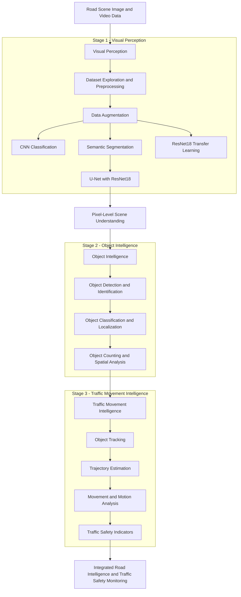

# System Architecture

## 1. Architecture Overview

The AI-Powered Smart Road Intelligence and Traffic Safety Monitoring System is designed as a modular computer vision solution that progressively transforms road-scene visual data into actionable traffic and road safety intelligence.

The architecture follows three major stages:

1. **Visual Perception:** Understanding road scenes through CNN-based classification and semantic segmentation.
2. **Object Intelligence:** Identifying, classifying, locating, and analyzing individual objects within road scenes.
3. **Traffic Movement Intelligence:** Understanding the movement, trajectories, interactions, and behavior of objects over time.

The implementation follows a progressive development approach. It begins with conventional CNN-based image classification, advances to pixel-level semantic segmentation, and subsequently extends towards object-level understanding and temporal traffic analysis.

The reference implementation for the visual perception foundation is covered by seven Jupyter notebooks (01–07). The subsequent object intelligence and traffic movement intelligence stages are part of the overall system architecture and will be detailed as their corresponding notebooks are implemented.

## 2. Overall System Architecture

The system architecture is organized into three interconnected stages.

The three stages build upon one another:

- Visual perception establishes an understanding of the road environment.
- Object intelligence extracts information about individual road users and relevant objects.
- Traffic movement intelligence analyzes how those objects move and interact over time.

Together, these stages provide the foundation for an integrated road intelligence system.

## 3. Stage 1: Visual Perception

### 3.1 Dataset and Input Processing

The current reference implementation uses the CamVid road-scene dataset, which provides road images and corresponding pixel-level semantic annotations.

The dataset contains multiple semantic categories, including:

- Road
- Building
- Sky
- Sidewalk
- Car
- Pedestrian
- Tree
- Traffic Light
- Column and Pole
- Lane Markings

The annotated masks provide the ground-truth information required for supervised semantic segmentation.

### 3.2 Data Preprocessing

The preprocessing pipeline prepares the original images and annotation masks for model consumption.

The major processing operations include:

- Image and mask validation.
- Consistent image and annotation pairing.
- Conversion of color-coded masks into integer class IDs.
- Handling of undefined or ignored annotation pixels.
- Image resizing and normalization.
- Dataset partitioning into training, validation, and testing subsets.

The segmentation masks use integer class identifiers, with `255` reserved as the ignore index for pixels excluded from the training loss.

Images and masks undergo compatible spatial transformations to preserve pixel-level correspondence.

### 3.3 Data Augmentation

Data augmentation introduces controlled variations into training images to improve the model's ability to generalize across different road-scene conditions.

Image transformations are applied consistently to their corresponding segmentation masks wherever spatial alignment is required.

The augmentation pipeline is used during training rather than as a replacement for the original validation and test data.

### 3.4 Baseline CNN – Image Classification

The initial model establishes a conventional CNN-based image classification pipeline.

Its architecture consists of:

1. Input image processing.
2. Convolutional layers for feature extraction.
3. Non-linear activation functions.
4. Pooling operations for spatial dimensionality reduction.
5. Fully connected layers.
6. Output classification layer.

The model learns visual features from road-scene images and produces image-level class predictions.

This provides a foundational implementation of CNN-based feature extraction and classification.

However, image classification produces a prediction for an entire image and does not identify the precise spatial locations of individual objects or road elements.

This limitation motivates the transition to semantic segmentation.

### 3.5 Baseline CNN – Semantic Segmentation

The next implementation extends CNN-based processing from image-level classification to pixel-level prediction.

Unlike classification, semantic segmentation assigns a semantic class to each pixel in the input image.

The segmentation CNN uses convolutional feature extraction and spatial prediction layers to generate a multi-channel output corresponding to the semantic classes.

The output has the following conceptual structure:

- Input: Road-scene image.
- Feature extraction: Convolutional layers.
- Prediction: Per-pixel class scores.
- Output: Semantic segmentation map.

The segmentation model establishes the baseline implementation for understanding the spatial distribution of road elements.

### 3.6 Improved Segmentation – U-Net with ResNet18 Encoder

The improved segmentation architecture combines the U-Net encoder-decoder structure with a ResNet18-based feature extraction backbone.

**ResNet18 Encoder**

ResNet18 is used as the encoder to extract hierarchical visual features from the input image.

Its residual connections facilitate feature learning by providing shortcut connections across convolutional blocks.

The encoder progressively captures higher-level semantic information while reducing spatial dimensions.

**U-Net Decoder**

The decoder progressively reconstructs spatial resolution through upsampling operations.

It incorporates corresponding encoder feature maps through skip connections.

These connections help retain spatial details that may otherwise be lost during successive downsampling operations.

**Segmentation Output**

The final prediction layer produces class-wise pixel predictions for the semantic categories.

The resulting segmentation map provides spatially detailed information about road elements, vehicles, pedestrians, infrastructure, and other scene components.

This architecture combines the feature extraction capabilities of ResNet18 with U-Net's spatial reconstruction capabilities.

### 3.7 ResNet18 Transfer Learning

A separate reference implementation applies transfer learning using ResNet18.

Instead of learning all visual representations exclusively from the road-scene training dataset, the model leverages features learned through prior training.

The implementation adapts the pretrained network to the project's target prediction task.

The primary architectural components are:

- Pretrained ResNet18 backbone.
- Feature extraction layers.
- Task-specific classification head.
- Model training and prediction pipeline.

This implementation demonstrates the use of transfer learning for road-scene visual recognition and complements the semantic segmentation architecture.

## 4. Stage 2: Object Intelligence

### 4.1 Objective

The object intelligence stage extends the visual perception foundation from understanding the overall road scene to identifying and analyzing individual objects within it.

While semantic segmentation identifies the category of each pixel, object intelligence focuses on individual instances and their spatial characteristics.

The objective is to understand what objects are present, where they are located, and how they relate to the surrounding road environment.

### 4.2 Planned Capabilities

The planned capabilities include:

- Object detection and identification.
- Classification of relevant road users and environmental objects.
- Object localization within the road scene.
- Object counting and distribution analysis.
- Extraction of spatial characteristics.
- Understanding the relationship between detected objects and road regions.

Relevant object categories may include:

- Cars and other vehicles.
- Pedestrians.
- Bicycles and two-wheelers.
- Large animals.
- Road infrastructure and obstacles.

The final object categories and model architecture will be determined during implementation.

### 4.3 Relationship with Visual Perception

The visual perception stage provides the semantic and spatial context required by the object intelligence stage.

Semantic segmentation provides information about road regions, sidewalks, buildings, vehicles, pedestrians, and other scene elements.

Object intelligence builds upon this foundation to distinguish and analyze individual objects rather than relying solely on pixel-level class assignments.

This transition enables more detailed understanding of road users and their spatial relationships.

### 4.4 Implementation Status

This stage is planned as part of the overall system architecture.

Its detailed model selection, network architecture, feature extraction approach, training pipeline, and implementation sequence will be documented after the corresponding notebooks are developed.

## 5. Stage 3: Traffic Movement Intelligence

### 5.1 Objective

The traffic movement intelligence stage extends the system from static scene understanding to temporal analysis of road users and their movements.

Unlike image-based perception and object intelligence, this stage processes video sequences to understand how objects move, interact, and behave over time.

The objective is to derive movement-related information that can contribute to traffic monitoring and road safety assessment.

### 5.2 Planned Capabilities

The planned capabilities include:

- Video frame processing.
- Object tracking across successive frames.
- Object identity association between frames.
- Trajectory estimation.
- Direction and movement analysis.
- Motion characteristics and speed estimation where suitable spatial calibration is available.
- Interaction analysis between vehicles, pedestrians, and other road users.
- Identification of potentially unsafe movement patterns.
- Generation of traffic safety indicators.

These capabilities will help transform individual object detections into a continuous representation of traffic movement.

### 5.3 Object Tracking and Trajectory Analysis

Object tracking will establish associations between objects detected in successive video frames.

The resulting object tracks can be used to estimate trajectories and understand movement patterns.

Trajectory information provides a basis for analyzing:

- Vehicle movement across road segments.
- Pedestrian movement and crossing behavior.
- Interactions between vehicles and pedestrians.
- Potential conflict zones.
- Unusual movement patterns.

Actual speed and physical distance estimation will require appropriate camera calibration and scene geometry considerations. Pixel displacement alone should not be treated as a reliable measure of real-world distance or speed.

### 5.4 Traffic Safety Indicators

The movement analysis stage is intended to support the development of traffic safety indicators.

Potential indicators include:

- Vehicle and pedestrian movement patterns.
- Traffic density and movement distribution.
- Potential vehicle-pedestrian conflicts.
- Unsafe proximity and interaction patterns.
- Unusual or potentially hazardous trajectories.

These indicators will provide a foundation for identifying potentially unsafe road conditions.

### 5.5 Implementation Status

This stage is planned as part of the overall system architecture.

The detailed tracking algorithms, trajectory representation, temporal processing pipeline, movement estimation techniques, and safety indicator calculations will be documented once the corresponding notebooks are implemented.

## 6. Reference Implementation and Notebook Mapping

The current reference implementation consists of seven notebooks covering the visual perception foundation.

| Notebook | Implementation | Architectural responsibility |
|---|---|---|
| `01_dataset_exploration.ipynb` | Dataset exploration | Understand dataset structure, annotations, classes and distributions. |
| `02_data_preprocessing.ipynb` | Data preprocessing | Prepare images, masks, metadata and dataset partitions. |
| `03_data_augmentation.ipynb` | Data augmentation | Implement transformations for training data. |
| `04_baseline_cnn.ipynb` | Baseline CNN classification | Establish the image-level classification pipeline. |
| `05_baseline_segmentation_cnn.ipynb` | Baseline CNN segmentation | Establish the pixel-level segmentation pipeline. |
| `06_improved_segmentation_unet_resnet18.ipynb` | U-Net with ResNet18 | Implement the encoder-decoder semantic segmentation architecture. |
| `07_resnet18_transfer_learning.ipynb` | ResNet18 transfer learning | Implement pretrained CNN feature extraction and task adaptation. |

The subsequent stages will extend the notebook-based implementation.

| Planned stage | Expected implementation areas | Status |
|---|---|---|
| Object Intelligence | Object detection, classification, localization, counting and spatial analysis | Planned |
| Traffic Movement Intelligence | Video processing, object tracking, trajectory estimation, motion analysis and safety indicators | Planned |

The exact notebook allocation and technical responsibilities for these future stages will be established during their implementation.

## 7. Architectural Rationale: Classification to Semantic Segmentation

The initial implementation uses image classification to establish a foundational CNN pipeline.

However, the project's primary objective involves understanding road scenes and identifying the spatial distribution of relevant road elements.

Image-level classification alone cannot provide this information because it assigns predictions to an entire image rather than individual pixels.

Semantic segmentation is therefore a more suitable architectural approach.

It provides:

- Pixel-level identification of road surfaces and boundaries.
- Spatial differentiation between vehicles, pedestrians and infrastructure.
- Identification of sidewalks, buildings, vegetation and other environmental elements.
- A structured representation of the road environment.
- A foundation for subsequent object-level analysis and traffic safety applications.

The transition from baseline classification to semantic segmentation represents an architectural progression towards richer spatial understanding of road scenes.

The U-Net architecture with a ResNet18 encoder further strengthens this approach by combining hierarchical feature extraction with spatial information recovery through decoder skip connections.

The subsequent object intelligence and traffic movement intelligence stages extend this spatial understanding into object-level and temporal analysis.

## 8. Overall Data Flow and Integration

The intended end-to-end data flow can be summarized as follows:

**Input Data → Visual Perception → Object Intelligence → Traffic Movement Intelligence → Road Safety Intelligence**

Each stage contributes a different level of understanding:

| Stage | Primary input | Expected output |
|---|---|---|
| Visual Perception | Road-scene images | Image-level predictions and pixel-level semantic maps |
| Object Intelligence | Road-scene images and visual perception outputs | Identified objects, classifications, locations and spatial information |
| Traffic Movement Intelligence | Video sequences and object-level information | Object tracks, trajectories, movement characteristics and safety indicators |
| Integrated Road Intelligence | Outputs from all stages | Structured understanding of road conditions and potential traffic safety risks |

The architecture is designed to be modular so that individual stages can be developed, validated, and subsequently integrated into the overall system.

## 9. Implementation Scope and Documentation Boundaries

This architecture document describes both the implemented reference architecture and the planned evolution of the complete system.

**Implemented scope**

Notebooks 01–07 represent the current reference implementation and are documented with their respective technical responsibilities and model architectures.

**Planned scope**

Object intelligence and traffic movement intelligence are included in the overall architecture to establish the intended direction of system development.

Their detailed technical design will be incorporated as their corresponding notebooks are implemented.

Experimental investigations, hyperparameter tuning trials, comparative performance analysis, metric interpretation, and experiment-specific conclusions are intentionally outside the scope of this architecture document.

Such findings should be maintained separately in the experiment documentation and final project report.
